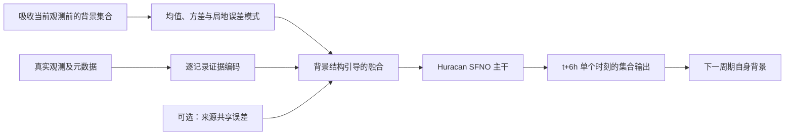

# 背景误差结构引导的观测融合：整体研究 Plan

**v9 · 2026-10-13 · 已按用户的 6h 单步输出设定修订 · 研究提案，尚无新方法实验结果**

工作题目：**Background-Structured Evidence Fusion for Observation-Driven Weather Prediction**。工作简称 BSEF，仅用于组织实验。

实施底座为用户已适配单步输出的 Huracan。此前检查的参考提交为 [jialiangZ/huracan@5c3a4eb](https://github.com/jialiangZ/huracan/tree/5c3a4eb689ea63325f39a6ee9ebb6cd3b15b3f6f)；后续以用户当前版本的单输出接口为准。硬件按单张 RTX 4090 24 GB 规划，未实测训练显存或吞吐。

## 1. 研究目标与引入方式

观测与背景之间出现相同幅度的差异，并不意味着应产生相同的天气修正。差异可能来自天气系统的位置误差、强度误差，也可能包含某个观测来源的共享误差。融合需要同时回答两个问题：**观测提供了多少有效证据，以及这些证据应修正背景的哪些方向。**

本研究检验以下假设：背景集合中随天气情势变化的空间、跨变量协同结构，可以帮助观测驱动更合适的修正；当观测来源存在相关误差时，联合表示天气修正与来源共享误差，可减少错误更新及过度自信。背景集合只是误差结构的估计，不能被视为正确的真值范围。

论文可按以下逻辑展开：

1. 观测驱动天气系统需要在不断变化的背景质量与观测网络下融合信息。
2. 只知道局地背景均值、方差和单条观测置信度，并不足以区分不同的天气修正方向。
3. 集合结构提供“背景可能怎样错”的线索，来源关系提供“观测证据是否独立”的线索。
4. 提出联合利用两者的融合接口，并通过受控机制实验、真实观测验证和连续循环检验其价值。

上述第二点是待验证的机制假设，不预先声称所有现有神经同化方法都存在这一缺陷。

## 2. 与已有工作的关系及贡献边界

| 相关工作 | 已有能力 | 本研究需要额外证明的部分 |
|---|---|---|
| [Huracan](https://arxiv.org/html/2508.18486v2) | 观测驱动的集合天气系统 | 显式背景集合交互相比现有融合的收益 |
| [FengWu-Adas](https://arxiv.org/html/2312.12462) | 门控背景—观测交互及置信度处理 | 误差方向建模是否超过强双向 attention |
| [Learning Enhanced Ensemble Filters](https://arxiv.org/abs/2504.17836) | 从集合分布学习更新 | 在真实天气观测与来源变化下的机制及证据 |
| [CADA](https://arxiv.org/abs/2510.06637) | 对预训练自回归扩散模型学习控制 | 本研究的价值不能归结为“冻结模型＋学习修正” |
| [联合观测与模型偏差估计](https://doi.org/10.1175/MWR-D-16-0273.1) | 经典状态增广与误差归因研究 | 具体神经融合机制的收益，不能声称首次联合估计 |

候选贡献按优先级排序：

- **主贡献：背景误差结构引导的融合。** 学习观测对局地、多变量背景修正方向的支持，使更新显式依赖集合协同结构。
- **第二贡献：来源共享误差与天气修正的联合证据表示。** 在真实元数据足够、初步诊断支持相关误差假设时开展。
- **结构性质：可合并的证据接口。** 保留 v8 的同证据集合排列、分批一致性；作为可验证性质，不单独包装为主要创新。
- **检验场景：观测稀疏化、来源留出、中断与恢复。** 属于实验，不扩张为额外方法贡献。

双向 attention、集合协方差、Schur 补、来源去重以及多层残差注入均不能单独作为新贡献。来源潜变量不自动等于可识别的真实传感器偏差。

## 3. 任务定义：先与现有仓库保持一致

全部后续实验统一使用两个状态时刻 `(t−6h, t)`，每次调用仅输出 `(t+6h)`，每次前进 6h，配置为 `model.outputs_per_call: 1`。下一次调用使用状态对 `(t, t+6h)`。第一阶段研究的是**观测融合后的概率预测及其循环运行**，不能把输出直接称为同一时刻的分析后验。这里明确采用本项目的 6h 步长，不借其他模型的名称推断其原生时间间隔。

定义背景集合 `B_t = {b^k_(t−6h), b^k_t}_{k=1}^K`。它必须在吸收当前窗口的观测前生成。每次调用的新增观测集合为 `O_t = {y_i: t−6h < t_i ≤ t}`；下一次调用使用 `(t, t+6h]`，保留实际测量时间偏移。这些新增证据窗口不重叠。

两帧状态输入不意味着需要两份新增观测窗口。如果现有接口仍保留两帧观测槽位，前一帧只能作为明确标记的历史上下文，或在新证据分支屏蔽；不能把已经进入背景的旧记录再次累加为独立证据。所有对照统一历史观测可见性与处理规则。档案没有真实到达时间时，只能声称 measurement-time cutoff，不能声称业务延迟已经验证。

目标为学习 `p_phi(x_(t+6h) | B_t, O_t, forcing)`，训练参考为 ERA5，测量值来自真实 IGRA/ISD 档案。主训练与推理不需要预定义物理观测算子；仍需学习表示对齐，并在站点验证时进行统一的时空、变量匹配。

展开 L 次调用需要两帧初始状态和 L 帧目标，覆盖 6L 小时。1/2/4/8 次调用分别对应 6/12/24/48h；1/3 天预报分别需要总计 4/12 次调用；30/60/90 天循环分别需要 120/240/360 次调用。这里的总调用数包含首个产生 t+6h 的调用。

如后续需要严格的同一时刻分析输出，应另设分析头及时间协议，并对全部对照统一改造；不与第一轮实验同时开展。

## 4. 方法设计

### 4.1 保留 SFNO 核心，改变融合结构

第一版在输入编码后插入一个融合模块，保留原 SFNO 的谱滤波和 Swin 运算。第二版才比较在第 2、4 个 block 后重复读取证据的效果，位置是试验设定，不是已知最优。比较位置时尽量匹配参数量、训练预算，并单独报告耗时。

### 4.2 背景误差模式

使用所有成员共享的局地线性投影，将两个时间的多变量背景压缩到小维度表示。对成员离差构造局地协方差，提取低秩因子 `U_b`，使 `U_b U_b^T` 近似该协方差。原型使用 `K=8`、局地表示维度 32、秩 `r=4`，均为待验证超参数。

天气表示修正写成 `delta h = U_b a + r_phi`：`a` 控制集合支持的修正方向，`r_phi` 是受约束的补充修正，用于背景集合未覆盖的误差。对所有对照保留可比的补充通道，避免优势来自额外容量。

模式的符号、排序不是物理信息。融合尽量通过协方差或基不变的线性求解实现；需要检验成员排列、模式符号翻转及退化特征空间旋转不会任意改变输出。小集合协方差采用局地化、收缩和稳定求解。

### 4.3 背景条件下的证据融合

一个可实现的起始参数化是在潜空间建立兼容关系：

\[
z_i = A_i(B_t)a + L_i b_{g(i)} + \epsilon_i,
\qquad \epsilon_i\sim\mathcal N(0,D_i).
\]

`z_i` 由观测值、实际位置、时间、变量及背景均值共同编码；`A_i` 表示该观测对天气修正模式的响应；`b_g` 表示某个来源的共享潜在误差。可令 `A_i=R_i U_b`，其中 `R_i` 是学习到的局地线性读取关系，避免网络任意依赖模式编号。它是学习到的潜空间兼容模型，不是物理测量方程。

第一轮令来源项为零，只检验方向信息。后续设 `a~N(0,I)`、`b_g~N(0,Gamma_g)`，逐条累积联合精度与信息向量，合并同一来源的全部记录后再消除共享变量。天气先验只加一次，来源先验每个来源只加一次。用 Cholesky 求解得到修正表示及不确定性，再注入主干；不显式计算矩阵逆。

独立来源需要合理依据。同站多时次、同一探空报告内的测量可作为起始分组，设备和处理元数据可用时再细化。不同档案中的同一测量先身份核验；不能直接将整个 ISD 或 IGRA 当作一个误差源。

对 `D_i`、`Gamma_g` 设置下界、收缩和容量约束，防止模型靠放大观测误差而忽略观测。没有独立锚定证据时，不评价真实偏差“恢复率”；只评价预测、校准及已知干预下的响应。

### 4.4 保留 v8 的一致性边界

固定同一窗口的原始背景、观测身份和来源分组，逐记录编码不依赖到达批次，先累积后求解。同一证据集合一次到齐或分批到齐，应得到一致的证据摘要。

主干不同层可以读取同一摘要，但不能反复把它当作新增独立证据。若编码依赖不断变化的临时分析，应重算全部证据，不能沿用旧缓存而继续声称严格可合并。不同观测子集不要求输出相同。空观测只保证约定的旁路行为，不保证任意自身循环背景上的预报分数不变。

## 5. 数据与训练策略

真实主实验先保留 48×96 全球网格、72 个状态变量和现有 IGRA/ISD 数据。粗网格的代表性误差必须纳入解释，不能将所有观测—背景差异归因于传感器。

先修复预处理、时间划分和指标问题，再建立修正后的共同基线。最低可行划分为：2010—2011 训练、2012 验证、2013 测试；如已有 checkpoint 用过 2013，则该年不能重新宣称为未见测试，正式测试应追加所有相关模型均未训练或调参的年份。所有阶段及缓存生成器遵守同一划分。首选按日期生成索引，不硬编码忽略闰年的长度。

训练分三层：

1. **缓存背景、单次调用。** 固定背景生成器，训练融合模块，少量解冻须对各组一致。
2. **自身背景、短循环。** 从 2 次调用（12h）扩展到 4 次（24h），需要更长窗口时再到 8 次（48h），使用各方法自身输出；共同缓存上的收益不能代替这一验证。若需要保持旧训练方案的日历跨度，应按 6h 步长重新换算调用数。
3. **长循环、释放预报。** 不周期性用 ERA5 重置，比较多季节连续 30 天窗口，再扩展 60—90 天。

训练先使用两个集合成员（M=2）的 fair CRPS；每个成员每次只输出 t+6h 的一个状态场，成员数与输出时间步数是不同维度。须明确独立抽样条件；相互作用的在线集合不能无条件声称其估计无偏。评估统一报告固定成员数的 empirical CRPS，fair 版本可作为另外一项明确命名的诊断。空间权重和变量标准化规则对所有方法一致。

## 6. 实验矩阵

| 编号 | 背景表示 | 来源处理 | 用途 |
|---|---|---|---|
| R0 | 原始逐成员输入 | 修正后的原融合 | 仓库基线 |
| R1 | 均值、方差、相同锚点背景 | 独立记录误差 | 简单不确定性融合 |
| R2 | 均值、方差、低秩相关结构 | 独立记录误差 | 主机制 |
| R3 | 与 R1 相同 | 来源共享误差 | 来源项单独作用 |
| R4 | 与 R2 相同 | 来源共享误差 | 完整方法 |
| R-attn | 相同背景集合、原始观测和来源元数据 | 强普通 attention | 同信息预算基线 |
| R-simple | 选择最强基础融合 | 稀疏化／固定相关模型／验证集调参的误差膨胀 | 排除简单解释 |

R1—R4 使用相同观测编码、空间覆盖、训练数据、损失、初始化来源和输出采样策略。R0 主要提供系统参照，创新归因以匹配后的对照为主。冻结微调和全量微调分开比较。

必做实验：

- **E0 数据与机制诊断。** 集合方差能否反映误差？模式投影是否比匹配秩的随机子空间更能解释误差？投影使用真值只作事后诊断。
- **E1 真实观测下的基础收益。** 评估一次融合调用产生的 6h 场，以及从同一观测截止点继续自回归得到的 12h、1/3 天预报。释放预报阶段不加入新的观测；持续同化得到的后续场另列结果。同时检查无观测位置和变量。
- **E2 方向机制。** 已知真值的简化问题控制背景均值、逐点方差而改变相关结构。真实天气另做离差重排诊断，但不把失去物理一致性的重排样本当作真实场景。
- **E3 网络与来源变化。** 匹配覆盖的记录稀疏化、站点留出及报告组留出；已知共享偏差注入仅用于辅助压力测试，不能替代原生观测上的证据。
- **E4 循环中断与恢复。** 中断 1/2/4/8 次调用，对应 6/12/24/48h；如需 96h 压力场景则中断 16 次。恢复时间阈值在验证集预先确定，报告超额误差面积和恢复后短期预报。
- **E5 结构与成本。** 输入端 vs 主干内融合、K=4/8、秩=0/2/4（r≤K−1）、补充通道、简单膨胀，以及时间和峰值显存。

主指标为面积加权 CRPS、集合均值 RMSE；同时报告离散度—误差关系和留出真实观测误差。站点区间覆盖率必须处理观测噪声与代表性误差，不能直接用状态集合区间解释观测分布。ERA5 可能同化过留出观测，须披露；留出输入不等于独立真值。

## 7. 阶段门槛与论文证据

| 阶段 | 进入下一阶段的条件 |
|---|---|
| G0 可信基线 | 数据、窗口、指标回归检查通过；checkpoint 来源与数据版本可追踪 |
| G1 方向信息有效 | R2 在验证时段优于 R1，并超过或表现出区别于强 attention 的机制收益；否则先分析集合质量 |
| G2 联合建模必要 | R4 相对 R2、R3 及简单膨胀具有稳定收益；否则删除来源主贡献 |
| G3 系统价值成立 | 自身背景循环稳定，收益延续到预报，成本可接受 |
| G4 投稿证据完整 | 独立测试、至少 3 个训练种子、多季节、强基线及机制干预齐全 |

预先指定验证主分数：固定变量组在 6h、12h、24h、72h 的等权平均相对 CRPS skill，各变量先单独计算再平均。阶段 G1 可采用“验证集平均 skill 至少约 1%，且关键变量无持续超过约 2% 的退化”作为工程筛选阈值；这是建议的投入决策，不是顶会标准。阈值在运行新方法前冻结，测试集只在方案锁定后使用。

不把相邻格点当作独立样本。按天气过程或时间块进行配对 bootstrap，并报告种子差异；小样本宽区间应判为证据不足。

第一轮 48×96 结果定位为可行性证据。冲击 AI 顶会还需要可推广的机制、充分强的对照和真实网络变化下的稳定收益。若只发现更大输入容量带来小幅提升，应缩小贡献表述；若方向假设失败，应调整方法而不是继续堆叠模块。

## 8. 本版相对 v8 的决策

- 实施底座改为已复现的 Huracan；GenCast 迁移不列为当前必做项。
- 主线从观测证据管理深化为背景误差结构与观测证据的交互。
- 来源共享误差保留为第二阶段主线候选；一致性保留为结构性质。
- 保留 SFNO 的谱运算，先改输入融合，再验证少量主干内交互。
- 主实验坚持真实观测；理想化、人工扰动只用于机制诊断。
- 实施细节见 [4090 改动与初步实验计划书](./HURACAN_4090_IMPLEMENTATION_AND_PILOT_PLAN.md)。
